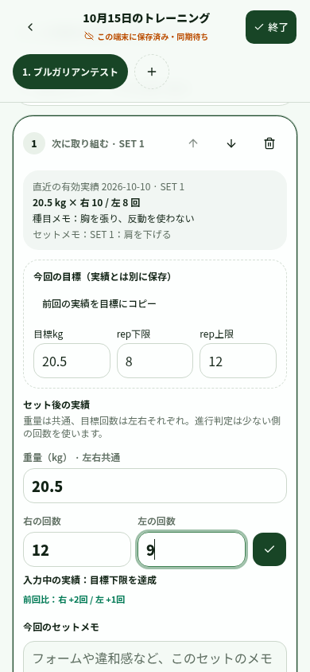

# 入力途中の整理・入力時検証・左右別回数

検証日：2026-10-15。PR #5 の `feat/mobile-progressive-overload`（`2b428cb`）を土台にした追加変更です。既存のPRは未マージのため、この変更のPRも #5 のブランチをbaseにしています。AGENTS.md は今回も見つかりませんでした。既存の同期・履歴変更・コピーの仕様を確認しました。

**公開サイトへのデプロイ、実DBへのmigration適用、Cloudflare API操作、実ユーザー記録の変更は行っていません。左右別の保存には、後述のDB変更ファイルを実環境へ適用したうえでアプリを反映する必要があります。**

## 変更内容

| 項目 | 変更後の操作・動作 |
| --- | --- |
| 入力途中の一覧 | ホームに「入力途中の記録を一覧で整理」を追加。「入力途中」を選ぶと期間全体の一覧を表示。月・日付・種目・部位の絞り込みと8件ページ切替も使用可能 |
| スワイプ削除 | 左へスワイプするとゴミ箱を表示。ゴミ箱を押して初めて削除。「…」からも同じ操作が可能。削除後、同じ一覧にいる間は「削除を取り消す」で戻せる |
| 削除の保存 | 完了扱いに変えず、active・終了時刻nullのまま論理削除。通信できなくても端末で保存し一覧から隠す。古いサーバー一覧やACKで復活させない。子の実績・メモは物理削除しない |
| 多数の記録 | 同期済みの削除後は表示中のページを再取得し、最後のページが空になったときは1ページ前に戻す。ローカルの削除待ちで先頭8件がすべて隠れていても、後ろの記録まで読み込む。古い再取得結果で取り消し後の表示を上書きしない |
| 目標の下限・上限 | 最後に編集した側を優先して、必要ならもう一方を同じ回数に調整。変更を欄の近くで案内。保存済みの逆転範囲はそのまま保持し、入れ替えボタンを表示 |
| 入力エラー | 回数の小数・範囲外、重量の範囲外・精度超過、記入し始めたセットの必須欄不足を、その入力欄に表示。無効な文字列は同期スナップショットに入れず、訂正まで完了を止める |
| 既存の逆転した目標 | サーバーは下限＞上限という関係だけを理由にスナップショットを拒否しない。送信済み/同期待ちmutationの本文・ID・baseVersionは変更しない。過去にその理由でblockedになったキューは、新サーバーの反映後に既存の「再試行」で送れる |
| 完了後の訂正 | 完了セットの実績を消した場合は未完了へ戻し、完了状態で空の実績を同期しない。履歴の編集保存も入力確認を通し、既存の終了日を維持 |
| 左右別の種目 | 種目作成で「左右別 · 共通の重量と右・左の回数」を選択。設定から既存種目の方式も変更可能。変更は次に追加する種目から反映し、既存ワークアウトの方式は変更しない |
| 左右別の記録 | 重量は共通で1欄、回数は右・左の2欄。両側を入力して1セットを完了。前回値・前回比・短い完了表示・履歴にも両側を表示 |
| 次セット・コピー | 新しいセットは目標だけを引き継ぎ、前セットの実績はコピーしない。同じメニューのコピーも方式は維持し、重量・左右の実績は空にする |

主な変更ファイル：`workout-summary-list.tsx` / `swipe-delete-row.tsx` と `draft-deletion.ts` が一覧・削除、`validated-number-input.tsx` / `workout-set-row.tsx` と `validation.ts` が入力検証、`types.ts` / `reps.ts` / `server-store.ts` / 各履歴・分析ストアが左右別の保存と読み取りです。

## 左右別の集計ルール

例：20.5kg、右12回・左9回。

- 1セットとして扱い、右・左を別のセットには数えません。
- 増量判定・回数PR・推定1RMには少ない側の9回を使います。両側が上限に達しない限り、回数上限達成による増量にはしません。
- ボリュームは20.5kg×(12+9)=430.5kg·repです。一覧・ローカル集計・PR・Analyticsで同じ扱いにします。
- 片側だけの入力は下書きとして残せますが、完了には両側が必要です。完了時は回数1〜999の整数、重量0〜2000kgを入力します。
- 既存の通常方式の記録は従来通り1つの回数で計算し、過去の回数を推測して左右へ複製しません。

## 保存形式とDB変更

追加ファイル：[`drizzle/0006_side_repetitions.sql`](../../../drizzle/0006_side_repetitions.sql)。Drizzleで差分を生成しただけで、実環境では実行していません。

- `exercise_master.rep_mode`：`standard` / `per_side`。既存は`standard`。
- `workout_exercise.rep_mode`：記録時点の入力方式。既存は`standard`。
- `workout_set.actual_reps_left` / `actual_reps_right`：左右の実績。既存はnull。
- `actual_reps`：左右別では少ない側の値をサーバーでも計算。既存の進行判定・集計との互換性を維持。

反映順序はDBの追加列→新しいサーバー/クライアントです。列がない状態でこのアプリだけを反映するとDB読み書きが失敗するため、**DB変更と合わせた反映が必要**です。過去データの回数を書き換えるUPDATEや物理削除は含みません。

既存のIndexedDBスキーマは変えていません。JSONスナップショットの任意項目を追加しています。FIFO・同じmutationの再送・atomic claim・version競合停止を維持し、activeのdelete/restoreとそのACKで状態を正しく保つ処理だけを拡張しました。認証・通信・競合といった実際の同期障害は引き続き表示します。

## 検証

`pnpm typecheck` / `pnpm lint` / `pnpm test` / `pnpm build` を実施。テストは30ファイル309件。

回帰ケース：activeの削除・再送・復元とversion競合、子データと終了時刻の保持、未同期create→delete→restoreと先行ACK、同時削除の二重キュー防止、古いサーバー表示からの復活防止、削除待ちで隠れた先頭ページ、逆転範囲の旧スナップショット同期、左右の保存・再読込・履歴・コピー、個別セットAPI・置換API、少ない側の判定、左右合計のボリューム、設定変更で既存方式を変えないこと、片側不足や小数回数の拒否を確認しています。

ブラウザーは375px・390pxのChromium。専用プロファイルと合成データを使用し、APIは全てfixture応答、アプリの画面・入力・IndexedDBは実際のコードを動かしました。キーボードで削除ボタンを開いて削除し、空の一覧から取り消す操作も確認しました。SQLはインメモリSQLiteで検証しました。公開Sitesや実DBに接続したE2Eではありません。

[操作ログ](browser-results.jsonl) / [スワイプ375px](swipe-375.png) / [削除と取り消し390px](deleted-390.png) / [種目作成](create-side-390.png) / [入力エラー](input-error-390.png) / [左右別セット375px](side-set-375.png) / [左右別セット390px](side-set-390.png) / [完了後の評価](side-result-390.png) / [履歴](side-history-390.png)



再現用：[`scripts/review-draft-cleanup-side-reps.mjs`](../../../scripts/review-draft-cleanup-side-reps.mjs)。localhost:3000の開発サーバーと、9223ポートの専用Chromiumを使用します。専用プロファイルのlocalhost保存領域をリセットします。

```sh
pnpm dev --host 0.0.0.0
chromium --headless --no-sandbox --disable-dev-shm-usage --remote-debugging-port=9223 --user-data-dir=/tmp/repwise-side-review about:blank
node scripts/review-draft-cleanup-side-reps.mjs
```

未検証：実機Safari/Chromeのスワイプ・キーボード、公開Sitesでの実サーバー同期、新migrationの実D1適用。実環境の既存同期キューは操作していません。今回の削除は論理削除で、完全削除や永続的なゴミ箱一覧は追加していません。取り消しはその一覧にいる間の操作です。
