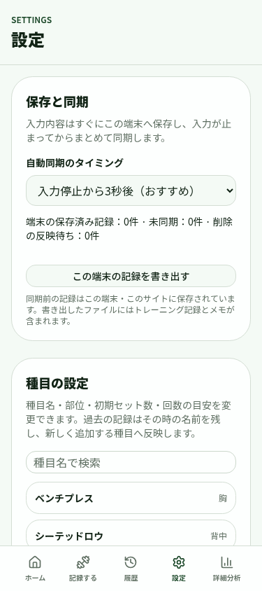
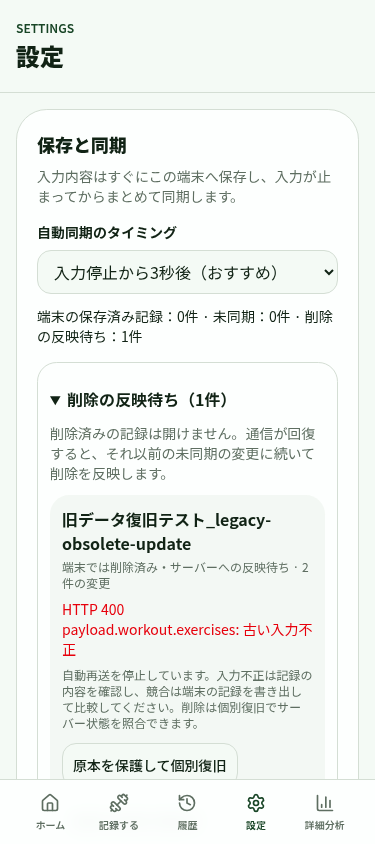
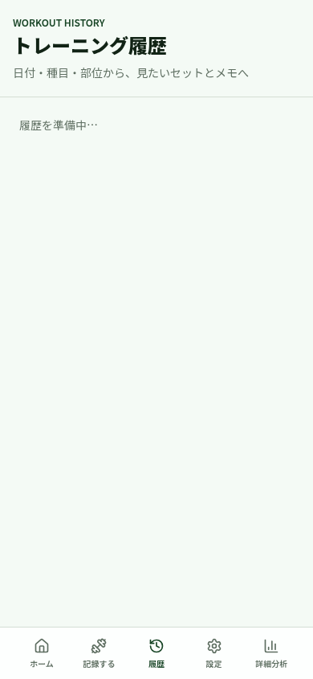
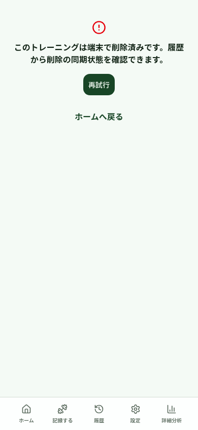

# 削除済み記録と旧同期キューの復旧

対象差分は PR #8 (`ce3bdc4`) を基準とする。公開デプロイ・マージ・実ユーザー記録の操作は行っていない。ブラウザの検証は専用 Chromium プロファイルの localhost のみで、アプリの全 API をテスト用レスポンスへ差し替えた。実ユーザーの IndexedDB を全消去する手順はない。

## 原因と最新コードでの確認

| 観察・問題 | 基準コードの状態 | 今回の対応 |
| --- | --- | --- |
| active の delete/restore が `payload.workout.status: 完了状態が必要です` で400 | API入口の誤検証は PR #8 で修正済み。HTTP入口を通す既存テストで確認 | その失敗キューを保存した端末を再起動するテストを追加。該当する古いエラーだけ、原本を退避して一度自動再試行 |
| 旧キューの残存 | 起動時には有効形式のキューの通常再送のみ。blocked は停止したまま | 特定エラーの復旧、最終削除意図のキャッシュ再構築、サーバー照合を伴う対象別復旧を追加 |
| 読めない形式が件数と書き出しから落ちる | 型ガードで除外。旧DB移行では試行済み要求のbaseVersionも推定していた | 形式未確認件数を表示、書き出しに全原本を含める。同じ記録の後続送信を止め、試行済み要求を推定変換しない |
| 別タブの古いACKが新しい削除の後に届く | キューから消えた要求でもキャッシュを更新し、後続キューが空なら古いoperationからdraftStatusを設定できた | キューにない要求のACKは無処理。新しいローカル状態を維持し、serverVersionを巻き戻さない。claimに60秒の期限、sequenceをDBトランザクション内で採番 |
| 一覧・カレンダーの古いGET結果 | GET前のローカル状態だけで合成 | 応答後の最新ローカル状態で合成。GET中にACKされた正常記録は消さない |
| 削除待ちの記録が分析へ残る | 分析はサーバーの保存済み状態だけを使用 | 端末の削除IDを読み取り専用の分析要求に添付し、サーバーで集計・PR・傾向を再計算。応答中に削除状態が変われば再取得。短期キャッシュ・表示も無効化 |
| 完了編集キャンセル後の詳細だけactive | 保存済み基準と編集データを分離する修正、および既知の不整合キャッシュの修復は PR #8 に存在 | その回帰テストと実ブラウザ操作を再実行。修復前の原本を保持。設定から個別修復可能。古い完了取得・別タブの編集が削除を上書きしない。未確認・不整合キャッシュを保持期限で消さない |
| delete/restoreの応答の子要素updatedAtとDB値が異なる | 親だけを保存する処理なのに応答内の子要素更新日時を変更 | 応答もDB同様に子要素の日時を維持 |

ユーザー報告の2件のIDは参照情報として扱い、サイト上で開く・変更する・削除する操作は行っていない。元端末のデータを読めないため、報告個体の原因・復旧結果を断定していない。旧400の保存形と既知の完了キャッシュ不整合は、テスト用データを実際にIndexedDBへ保存して再現した。

## 既存端末の復旧手順

1. この変更と前提のPR群が反映された版を開く。IndexedDBはversion 4へ更新され、`syncRecoveryArchive` が追加される。既存の記録・キューは保持する。古いタブで更新がブロックされた場合は、そのタブを閉じて再度開く。キャッシュやIndexedDBの全消去は不要。
2. 保存されていた active の delete/restore の上記の正確な400エラーは、`blocked` / `failed` のいずれでも原本を保護して一度だけ再試行する。mutation ID、payload、baseVersionは変更しない。再失敗したら停止表示に戻る。他の400を成功扱いしない。
3. 設定の「保存と同期」を確認する。通常の未同期、削除の反映待ち、キューがなく削除の確認情報もない旧データ、形式未確認データを分けて表示する。必要なら「この端末の記録を書き出す」で原本を保存する。書き出しには読めない形式と復旧前の退避データも含まれる。
4. 削除が古い更新に阻まれている対象では「原本を保護して個別復旧」を選ぶ。サーバーを照合した後、対象名・日付・version・完了/入力途中/削除状態を表示して確認する。サーバーが削除済みなら原本を退避し、残存キューを整理。未削除なら古いキューとローカル記録を原本として退避し、その最新server versionに対する新しい削除要求だけを作成する。元の未送信メモ・実績は退避先に残り、勝手にサーバーへ送らない。
5. 途中で別タブが変更・取り消しをした、同期中、古い要求がまだ適用可能、形式不明、サーバー不存在など判断がつかない場合は変更しない。書き出した原本で個別の確認が必要。サーバー不存在を根拠に未同期の作成を捨てない。正常な作成は通常FIFOで作成→削除まで同期できる。
6. 完了状態の不整合は、サーバーの確定した完了状態または保存済みの完了送信スナップショットで裏付けられる場合だけ復旧する。設定の「完了状態を復旧」も利用できる。未送信の編集や競合を推測で上書きしない。

復旧は記録ごとのIndexedDBトランザクションで、確認前に読んだdraftとキューが現在も同一か検査してから実行する。送信中は整理しない。新しい削除も通常のAPI version検証を通るため、照合後にサーバーが更新された場合は競合として停止し、端末の削除状態と原本を保持する。原本と削除情報には自動削除の期限を設けない。

## API契約・エラー

- 読み取り専用 `GET /api/v2/workouts/:id/sync-state` は、既存のownerスコープのサーバー取得を使い、削除済みも含むsnapshotまたは `null` を返す。通常の詳細GETは削除済みを引き続き404とする。no-store。
- 同一mutation ID・同一内容の再送は、version照合より先に保存済みの結果を返す。取り消しも別のimmutable mutationとしてFIFO処理する。この契約を維持し、削除済みだからといって別内容の400/409を成功に変えない。
- 別IDの古い削除・更新はversion競合、不明な対象への未処理要求は404で保護する。同じIDの成功済み要求の重複再送は200。全ての404/400を一律に消す処理はない。
- 一時的な通信失敗はbackoffして再試行。入力不正はblocked、version競合はconflictとして自動送信を停止。対象別のため、他の記録は同期を継続できる。
- 端末削除、サーバー反映待ち、失敗/競合、確認済みの削除を区別する。旧データでキューがないことだけを根拠に「削除同期済み」と表示しない。

## 検証

`pnpm typecheck` / `pnpm lint` / `pnpm test` / `pnpm build` を実行。33ファイル・355テストが成功。typecheck・lint・buildも成功。SQLite/D1ラッパーはテスト内のインメモリDBのみ。D1 migrationは追加・適用していない。

| 必須ケース | 検証方法 |
| --- | --- |
| 作成→即削除 | 既存の実API入口 create→delete テスト、サーバー不存在でも未送信作成を捨てない新規テスト |
| 更新の同期待ち中に削除 | 実ブラウザ2タブで未同期メモ→別タブで削除→更新と削除をFIFO同期 |
| 削除→取り消し→再削除 | 実API入口と既存ブラウザシナリオを再実行 |
| 同期済み削除の取り消し | 既存server restore/versionテスト・既存ブラウザシナリオ |
| 通信失敗→再読み込み→再試行 | 旧400キューの接続を閉じて再起動する新規テスト、ブラウザの失敗後reloadと再試行 |
| 削除後の古い更新・一覧取得 | SQLiteで遅れた更新を拒否、古い作成・削除再送でも削除を維持。IndexedDBの古いACKと遅延一覧取得もテスト |
| 同じ削除の重複送信 | 実API入口・SQLite既存/新規テスト |
| 旧形式の失敗キューで新バージョン起動 | raw IndexedDB fixtures、v2 DBの実upgrade、旧blocked/failed・deletedAtなし・baseVersion不明、ブラウザの再起動で検証 |
| 複数タブの更新と削除 | 2タブの実操作・共有IndexedDB・storage通知。残存更新のメモと削除の両方を検査。claimと遅いACKもテスト |
| 完了編集→キャンセル | 既存ブラウザシナリオを再実行（再読み込み・別タブ・評価/編集ボタン・queued completeを含む） |
| 正常な未同期記録を保護 | 復旧前後の完全一致・別記録の同期成功、原本内メモ・キューの保持をテスト |
| 履歴・カレンダー・分析から削除除外 | 最新のtombstoneによる一覧/カレンダー合成、分析の再計算と削除中の再取得。ブラウザでは履歴と再読み込みの非復活を確認 |

再実行コマンド：専用 Chromium (debug port 9223) と `pnpm dev` を起動し、`node scripts/review-draft-cleanup-side-reps.mjs --legacy-sync`。最初に**専用localhostテストプロファイルだけ**を初期化し、その後旧データを保存してreloadする。旧データを保存した後の初期化は行わない。既存フローは `--state-progress`、出力先は `REPWISE_REVIEW_OUTPUT_DIR` で指定できる。

証跡：[旧キュー・複数タブ結果](browser-results.jsonl)、[既存操作の再検証](existing-flow-results.jsonl)。

| 画面 | 証跡 |
| --- | --- |
| 旧400復旧後・375px |  |
| 古い更新が停止している削除待ち・375px |  |
| 個別復旧後・390px |  |
| 復旧後の履歴・390px |  |
| 別タブ削除で古い入力画面を閉じる・390px |  |

## 未確認・制約

- 公開サイトのユーザー元端末に残る実際の旧キューは取得できていない。今回確認したのは保存形式を再現したデータ。ユーザー報告個体2件の復旧成功とは同一視しない。
- 実端末Safari/iOS・Androidのソフトウェアキーボードは未検証。375/390pxのChromiumでは横スクロールなし、既存入力・完了フローを再検証した。
- 形式不明、サーバー不存在、送信中、競合で判断できない記録の自動破棄/自動マージ/JSON再取り込みは行わない。原本書き出しが個別調査の手段になる。
- 既存のPR群が未マージであるため、このPRのbaseはPR #8のブランチ。公開版に反映するには別途レビューとリリースが必要。この作業では公開操作をしていない。
