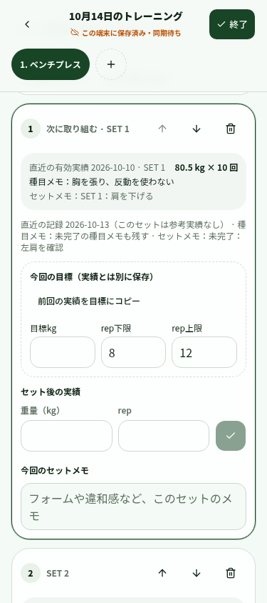

# スマートフォンのセット前後フロー改善レビュー

検証日：2026-10-14 UTC。対象：`kei8250/REPWISE`。

GitHub main は `9ccb8d0`。前回までの PR #1〜#4 は未マージのため、今回の変更は最新の開発ブランチ `fix/workout-finish-and-history-navigation`（`9b94287`、PR #4）を土台にしています。今回の PR の base も同ブランチです。PR のマージ、公開デプロイ、本番データの読み書き、D1 migration は実施していません。`.openai/hosting.json` の既存 project_id も変更していません。

## 確認した仕様と修正前の状態

`/workspace`、リポジトリと親階層を検索しましたが、AGENTS.md はありませんでした。同期・履歴編集・コピーの既存仕様（`docs/phase-1b-1-sync.md`、`docs/phase-1b-2a-history-changes.md`、`docs/phase-1b-2b-workout-copy.md`）と、進行判定・確定済み次回目標・ローカル保存の実装とテストを確認しました。

公開検証サイトへのアクセスは HTTP 401 でした。この実行環境には利用者のログインセッションがなく、公開サイト上で最新コードを操作したという検証はできていません。以下は修正前の開発コードを別のローカルサーバーで起動した結果と、修正後をローカルで操作した結果です。両方で同じ合成データを使っています。

| 項目 | 修正前のコードで再確認 | 修正後 |
| --- | --- | --- |
| セット前の表示 | 実績入力は常時表示、目標・今回メモは折りたたみ。前回の種目メモはセット欄にない | 未完了セットは有効な前回実績の日付・重量・回数・セット/種目メモ、今回目標、実績入力、今回メモを常時表示。完了セットは実績・メモ・前回比・目標下限達成を短く表示し再編集可能 |
| 種目全体の目標 | セット別目標が「設定済み」という説明だけ | 通信状態にかかわらず全セットの重量・回数範囲を一覧表示。異なる重量や回数もそのまま表示 |
| 参考実績 | 最新の記録の同じ位置を無条件に使い、空の未完了セットが「前回」に入る | 同じセット位置の有効な完了実績を全履歴から選択。直近の未完了記録のセット/種目メモは実績と分けて表示。過去一覧にも元のメモを保持。未実施として終了した種目でもメモがあれば残す |
| 判定の説明 | 必要数不一致などの理由が短く、今回の判定と傾向が近接表示 | 必要数・本番セット枠数・有効完了数・現在の回数設定に対する下限/上限達成数と条件を表示。今回の判定、複数回の傾向、自動提案、ユーザー確定目標を区別 |
| 次回提案 | 自動提案と保存目標の見分けがつきにくい | 参照日と適用ルールを表示。空欄セットへの採用は明示操作だけ。すでにある目標と実績を保持。確定済みの次回目標はその保存値を別枠に表示 |
| 履歴 | 月・日付と8件ページ切替。種目/部位で絞れない | 種目名（保存時の名前・現在の名前）と現在の部位を組み合わせて検索。SQLで検索してからページ分割し、未同期のローカル記録にも同じ条件を適用。条件はURLに保持 |
| 画面復帰 | 別タブなら入力維持。同じタブを離れると選択種目は先頭に戻る | 既存の端末保存に加えて、同じタブで選択種目・スクロール位置を復元。過去の記録を別タブで開く導線も維持 |
| 分析の部位選択 | 下部の一覧だけを絞り込み、上部に別部位の分析が残る | 上部の種目分析・選択肢も部位に連動。期間サマリーと部位別バランスが全身対象であることを明記。既存のホーム→分析、部位別一覧→種目分析の導線を維持 |
| 設定の参照 | 記録画面から回数範囲などをまとめて確認できない | 回数範囲・増量幅・初期セット数・休憩目安と設定画面への別タブリンクを追加。設定変更の影響を説明 |

## 参考実績と目標の扱い

- セットごとの参考実績は、同じ位置で `completed` / `working`、重量は0以上の整数グラム、回数は1以上の整数があるセットです。欠けた位置やスキップによってセット番号を詰めません。削除済み、現在のワークアウト、開始時刻より後の記録は除外します。最初の10件より古い実績も検索します。
- 種目全体の自動提案は、重量が正の値の有効実績を少なくとも1つ持つ直近の完了種目を参照します。その記録を選んだ後は、既存エンジンの厳密な条件をそのまま適用します。一部が未完了・不足・混在重量でも、それを飛ばして都合のよい古い「増量」判定にしません。
- 0kgの実績も保存・セット比較用の参照は可能ですが、既存の自動増量判定は正の重量が対象です。この違いを判定条件に記載しました。
- 「前回の実績を目標にコピー」は押したセットの目標のみを更新します。実績・完了状態・今回メモは更新しません。「空欄セットの目標に提案を採用」は目標3項目すべてが空の未完了本番セットだけが対象です。既存目標を自動で置換しません。
- 現在の保存済み目標と、進行ルールによる自動判定は別です。セットごとの結果は保存済み目標の下限と比較し、完了後の進行説明では現在の種目設定の下限・上限に対する実施数を示します。
- 同期のスナップショット、FIFO、atomic claim、version競合処理、IndexedDBのスキーマ、DBスキーマ、進行エンジンのルールは変更していません。画面復帰用のsessionStorageには選択種目IDとスクロール量だけを保存します。

## 種目設定変更の影響

現在の設計は過去のプロフィールを固定保存していません。そのため回数範囲・必要セット数・増量幅を変えると、過去記録を表示した際の自動判定・提案は現在の設定で再計算されます。保存済み実績・メモ・セット目標は変わりません。ユーザーが確定した次回目標もその値を保持し、再計算された提案とは別に表示します。新しく種目を追加すると新しい初期値を使います。部位検索は現在のマスター設定を使います。

## スマホ幅の操作結果

ローカルのChromium、375×844 / 390×844、モバイル・タッチエミュレーションで確認しました。APIはブラウザー側で全てテスト用応答に差し替え、画面・React入力・IndexedDBによる保存は実際のアプリを使っています。サーバー側SQLはインメモリSQLiteで別途検証しています。公開環境と実サーバーをつないだE2Eではありません。

- 前回確認→目標設定→小数重量/整数回数入力→セット完了→次セットへ移動を確認。完了操作は画面上の座標へのタッチイベントで実行し、44px以上の領域と遮蔽物がないことを確認しました。
- `82.75` を一文字ずつ入力でき、目標の変更・前回のコピーで空の実績欄が埋まらないことを確認しました。
- 375px・390pxでページ全体の横はみ出しなし。完了セットを畳み、次のセットを表示。種目タブは横送りを許す既存のナビゲーションです。
- ヘッダーの実測高さをスクロール余白に反映。入力を隠しにくくし、記録中の主要ボタン・種目タブ・セット操作を44px以上にしました。
- 390×480に高さを縮め、フォーカスした入力欄が固定ヘッダーより下・画面下端より上にあることを確認しました。実機キーボードを再現したものではありません。
- 同じタブで履歴へ移動して戻り、入力値・選択種目・スクロール位置を保持。種目/部位フィルターと再読み込み時の条件保持、部位選択後の上部分析の連動を確認しました。
- 既存の終了処理も再検証：チェックボタン未操作でも入力済みセットを保存。サーバーが古いactiveを返しても端末の完了記録を巻き戻さず、ホームに入力途中として出さないことを確認。19件の履歴が8/8/3件に分かれ、重複・欠落がないことも確認しました。
- ブラウザーの未処理例外なし。[実行ログ](browser-results.jsonl)も保存しました。

### 比較画像

| 幅 | 修正前（同じ合成データ） | 修正後（次のセット） |
| --- | --- | --- |
| 375px | [画像](before-375.png) | [画像](ready-375.png) |
| 390px | [画像](before-390.png) | [画像](ready-390.png) |

[目標入力後](goal-375.png) / [完了して次のセットへ](completed-next-375.png) / [完了セットの短い表示](completed-summary-390.png) / [画面高さを縮めた入力確認](keyboard-390.png) / [履歴フィルター](history-390.png) / [部位連動後の分析](analytics-390.png)



## 自動テスト

`pnpm typecheck`、`pnpm lint`、`pnpm test`、`pnpm build`を実施。自動テストは29ファイル294件。

新しい回帰ケースは、参考実績の欠けた位置・未完了・不正値、目標コピー時の実績保護、既存目標を保護した提案採用、目標だけの記録を完了実績に変換しないこと、必要数/達成数の説明、混在重量の判定保留、種目別増量幅、目標一覧/完了セットの表示、10件より前の参考実績、未完了メモ保持、同日開始時刻と未来/現在記録の除外、名前/部位のSQLとローカル検索、文字としてのLIKEワイルドカードを含みます。既存の同期・競合・コピー・終了・Analyticsテストも実行します。

再現用ブラウザースクリプト：[`scripts/review-mobile-progressive-overload.mjs`](../../../scripts/review-mobile-progressive-overload.mjs)。専用の空のChromiumプロファイルを使ってください。localhostの保存領域をリセットします。

```sh
pnpm dev --host 0.0.0.0
chromium --headless --no-sandbox --disable-dev-shm-usage --remote-debugging-port=9222 --user-data-dir=/tmp/repwise-mobile-review about:blank
node scripts/review-mobile-progressive-overload.mjs
```

`--baseline` は同じfixtureでlocalhost:3001の修正前コードを撮影するモードです。今回の撮影には `git archive 9b94287` で作成した別ディレクトリと、既存node_modulesへのシンボリックリンクを使いました。公開サイトや実DBには接続しません。

## 未検証・今回は追加していないもの

- 認証が必要な公開Sites上での操作、実機Safari/Chromeのキーボード、OSの文字サイズ拡大、実端末の片手操作。ブラウザーの幅・タッチ・表示領域の検証で代替できない部分として残しています。
- 休憩タイマーは既存コードにありませんでした。今回は設定の休憩目安を確認できるようにし、タイマー機能の追加は見送りました。セット前の確認と記録の操作を優先しています。
- 過去の判定ルールの固定保存は未対応です。今回その影響を画面に明記しました。固定保存には別のデータ設計が必要です。
